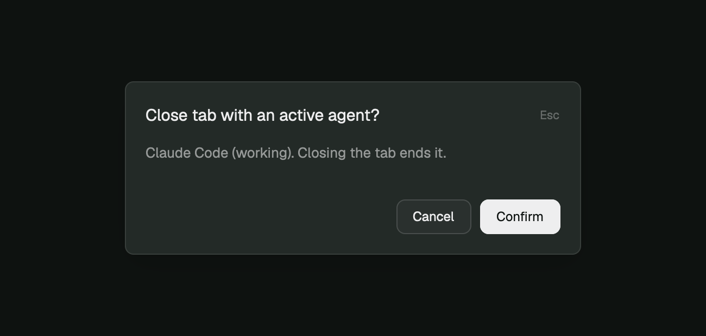

# herdr-close-guard

A confirmation dialog for [Herdr](https://github.com/herdrdev/herdr-app): closing a tab or space that still has an active agent asks first.



Out of the box, Herdr closes a tab the moment you press the key, agent and all. With this mod, a tab or space whose agent is **working** or **waiting on you** brings up a dialog that names the agent, with Cancel and Confirm. Tabs and spaces with no active agent close exactly as before.

## Requirements

- Herdr 0.1.16 or newer. Built and tested on macOS.

## Install

Ask your agent to add `github.com/reeeeeee-dev/herdr-close-guard` to Herdr, or do it by hand:

1. Copy `mods/close-guard/` to `~/.config/herdr-app/mods/close-guard/`.
2. Point your close-tab key at it in `~/.config/herdr-app/keys.json`:

   ```json
   { "global": { "cmd-w": "mod.open:close-guard" } }
   ```

3. `herdr-app check ~/.config/herdr-app/mods/close-guard`

That guards the key. The steps below guard clicks as well.

## Guarding the close button and the menus

Shipped mods are rewritten on every start, so do this in your own clones (`herdr-app do mod.clone --name tabs --as my-tabs`, `herdr-app do mod.clone --name menu --as my-menu`, then use the clones in your layout and tab bar).

Wherever a mod runs `run("tab.close", { id })`, open the guard instead:

```js
openOverlay({ mod: "close-guard", kind: "window", frame: "none", width: 1, height: 1, props: { kind: "tab", id } });
```

For a space, use `kind: "space"` in place of `run("space.close", { id })`.

## What counts as active

| Agent status | Dialog? |
|---|---|
| working | yes, shown as "working" |
| blocked | yes, shown as "waiting on you" |
| done, idle | no |

For a space, every tab in it is checked.

## What it does not cover

The command palette, the macOS menu bar, the picker's ctrl-d and `herdr-app do tab.close` run Herdr's close commands directly, so they close without the agent warning. A mod cannot intercept those.

## What it touches

- **Programs:** none.
- **Files:** none outside its own folder.
- **Network:** none.

## Good to know

- The dialog is Herdr's own `confirm` mod, so it follows your theme. Enter confirms, Esc cancels.
- Herdr's usual question when you close a space, or the last tab of one, still appears when no agent is active.
- The mod is opened as an unseen 1px window that decides at once and closes itself, so nothing flashes when there is nothing to ask.

`RECIPE.md` is the brief another agent can rebuild this mod from.
