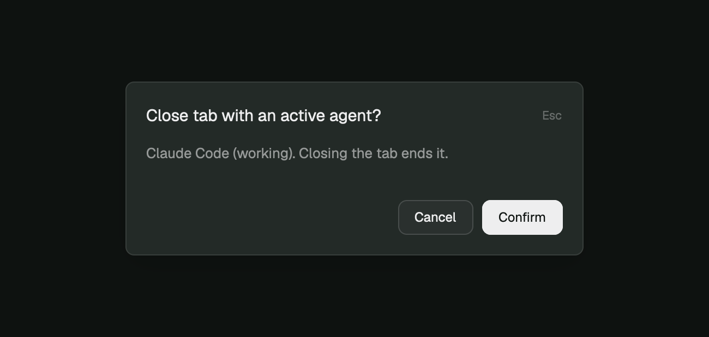

# Close guard

Closing a tab or space that still has an active agent asks first. A dialog names each agent that is working or waiting on you, with Cancel and Confirm. With no active agent, the tab or space closes as it always did, with nothing extra on screen.

**What you see**

- **Nothing, most of the time.** The mod has no place in the layout and draws no pixels of its own.
- **The dialog** (only when an agent is active; 420px wide, 160px tall, centered, the window dimmed behind it). It is Herdr's shipped `confirm` mod, so it follows the theme:
  - **Title** (15px, semibold, `foreground`): "Close tab with an active agent?" or "Close space with an active agent?". With more than one: "Close tab with 2 active agents?" (the count).
  - **Esc** hint at the top right (11px, `dim`).
  - **Detail** (13px, `muted`): each active agent as its program name and state, joined by commas, then what closing does. One agent: "Claude Code (working). Closing the tab ends it." Several: "Claude Code (working), OmO (waiting on you). Closing the space ends them."
  - **Cancel** and **Confirm** buttons at the bottom right.

**How it behaves**

- An agent is active when its status is `working` (shown as "working") or `blocked` (shown as "waiting on you"). `done` and `idle` agents are not active and never bring up the dialog.
- For a tab, the agents counted are those in that tab. For a space, those in any of its tabs.
- No active agent: the mod runs `tab.close {id}` or `space.close {id}` at once. Herdr's own behavior stays: `space.close`, and `tab.close` on a space's last tab, still ask their usual question.
- An active agent: the dialog opens. Confirm (or Enter) runs `tab.close` or `space.close` with `confirmed: true`, so Herdr does not ask a second time. Cancel, Esc or a click beside the dialog closes the dialog and leaves the tab or space as it was.
- An agent's name is its program's name ("Claude Code"), else what it reported as its app, else its terminal address.
- The key: `cmd-w` is bound to `mod.open:close-guard`, which guards the shown tab.
- Other callers (a tab bar's close button, a context menu's Close item) open the mod with `props` naming what to close.

**Built from**

- `mods/close-guard/main.js`: one `View`. All of the work is in `init`; `render` returns an empty `div()`.
- `mods/close-guard/mod.json`: `{ "place": "none", "title": "Close guard", "overlay": { "kind": "window", "frame": "none", "width": 1, "height": 1 } }`. A 1px frameless window is not seen, does not dim the window and does not take the keyboard.
- `props`: `{ kind: "tab" | "space", id }`. With none (opened by `mod.open`), `kind` is `"tab"` and `id` is the active tab of the active space.
- `init`, in order: return if `checking()`; `closeOverlay(props().overlay)` to close itself; find the active agents with `agents().filter((a) => a[kind] === id && (a.status === "working" || a.status === "blocked"))`; with none, `run(kind + ".close", { id })`; otherwise `openOverlay({ mod: "confirm", kind: "dialog", width: 420, height: 160, props: { title, detail, command: { name: kind + ".close", args: { id, confirmed: true } } } })`.
- `herdr` functions: `agents`, `spaces`, `run`, `props`, `openOverlay`, `closeOverlay`, `checking`. Commands: `tab.close`, `space.close`. Shipped mod: `confirm`. `gpui-kit`: `View`, `div`.
- `keys.json`: `{ "global": { "cmd-w": "mod.open:close-guard" } }`.
- Callers open it with `openOverlay({ mod: "close-guard", kind: "window", frame: "none", width: 1, height: 1, props: { kind: "tab", id } })` in place of `run("tab.close", { id })`, and the same with `kind: "space"` in place of `run("space.close", { id })`.
- It runs no programs, reads no files and does not reach the network.

**Watch out**

- A mod cannot import from another mod's folder (`resolves outside the application directory`), so the shared decision has to be a mod that others open, not a helper file they import.
- Open it as a `window`, never a `dialog`: a dialog dims the window and takes the keyboard for a frame even when there is nothing to ask.
- `init` runs for real during `herdr-app check`. Without the `checking()` guard, a check closes the shown tab.
- `herdr-app do` cannot pass `props` to a mod. From a shell only the no-props path can be driven (`herdr-app do mod.open --name close-guard`), and it acts on the shown tab.
- Only callers that go through the mod are guarded. The command palette, the macOS menu bar, the shipped `tabs` bar's close button, the shipped `menu`'s Close items, the `picker`'s ctrl-d and `herdr-app do tab.close` run the commands directly. Shipped mods are rewritten on every start, so wire the guard into your own clones of the tab bar and the menu.
- `mod.open` toggles: the mod must close itself in `init`, or the next press closes the guard instead of running it.
- Sub-agents count if `agents()` lists them under that tab or space.
- The button reads "Confirm" because the dialog is the shipped one; this mod does not restyle it.
- Built against Herdr 0.1.16 on macOS.

**Done when**

- `herdr-app check mods/close-guard` passes and `herdr-app status` shows no errors.
- With a working agent in the shown tab, `herdr-app do mod.open --name close-guard` lists `confirm` under `overlays` in `herdr-app status`, the dialog names that agent, and the tab is still there.
- `herdr-app do overlay.close` (or Cancel, or Esc) empties `overlays` and the tab is still in `herdr-app ls`.
- Once that agent is idle, the same command closes the tab with no dialog: the tab is gone from `herdr-app ls` and `overlays` stays empty.
- Confirm in the dialog closes the tab, and no second question follows.
